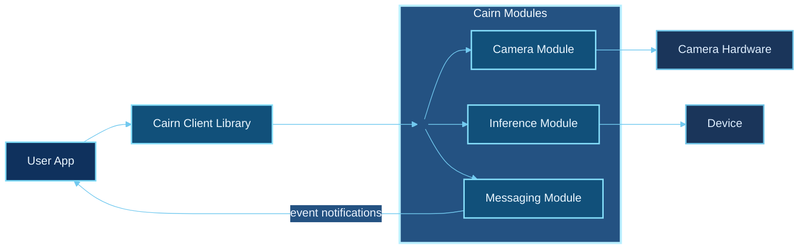

This section explains how the Cairn SDK is structured at a high level and how its components relate to and work with one another.

## Conceptual layers

- **User/Application layer**: Your product/app logic.
- **SDK library layer**: SDK client library and APIs.
- **Module layer**: SDK Modules providing core capabilities like camera management, inference, and messaging.
- **Device layer**: The device and its resources.

Below is a high-level view of how Cairn SDK components fit together for an application flow.

