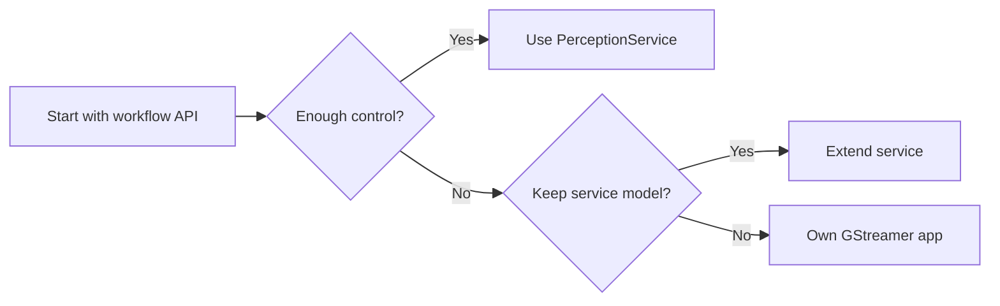

import Tabs from "@theme/Tabs";
import TabItem from "@theme/TabItem";

The standard Perception Module path is to describe a workflow with `PerceptionWorkflow` and let `PerceptionService` validate, deploy, and control it.

Use the advanced runtime path, or escape hatch, when your application needs to own the lower-level media graph or runtime behaviour directly.

:::caution Support boundary
This path is intended for advanced integration work and may not be directly supported in the same way as the `PerceptionWorkflow` API. Prefer the standard API when it can express your application.
:::

## When to use this path

Consider the advanced runtime path when you need to:

- add workflow operations that are not exposed by the Perception Module;
- use custom model, metadata, or post-processing behaviour;
- own the application image and runtime lifecycle;
- compose LVK GStreamer elements directly with other media elements;
- publish custom result payloads or integrate with a different messaging layer.

This path gives more control, but the application also owns more responsibility: pipeline design, runtime errors, reconnect behaviour, model compatibility, deployment packaging, and future compatibility with LVK runtime changes.

## Recommended decision

<div className="mermaid-compact">



</div>

## Option 1: Extend the Perception service

Extend or fork the service when you want to keep the same service lifecycle, validation, session control, and deployment model, but need extra capabilities.

This is usually the right path for:

- new workflow operations;
- new output types;
- additional validation rules;
- different orchestration behaviour;
- service-level integration with other Cairn modules.

## Option 2: Build a GStreamer application

Build a GStreamer application when you want direct ownership of the pipeline graph.

This path is easier if you build on top of the same base image as the Perception Service, because the expected runtime dependencies, LVK GStreamer plugins, and model assets are already aligned.

In this model, your application composes LVK elements such as inference, overlay, preview, and publishing elements inside a normal GStreamer pipeline. Cairn services can still be used where useful, for example to discover cameras or to publish events, but they are not the primary workflow controller.

A simplified application shape looks like this:

<Tabs groupId="runtime-language">
<TabItem value="python" label="Python">

```python
import gi

gi.require_version("Gst", "1.0")
from gi.repository import Gst

Gst.init(None)

pipeline = Gst.parse_launch(
    "pipewiresrc ! "
    "videoconvert ! "
    "ampinfer name=objects ! "
    "amposd ! "
    "ampsink"
)

pipeline.set_state(Gst.State.PLAYING)

try:
    bus = pipeline.get_bus()
    while True:
        message = bus.timed_pop_filtered(
            Gst.SECOND,
            Gst.MessageType.ERROR | Gst.MessageType.EOS,
        )
        if message is not None:
            break
finally:
    pipeline.set_state(Gst.State.NULL)
```

</TabItem>
<TabItem value="rust" label="Rust">

```rust
use gst::prelude::*;
use gstreamer as gst;

fn main() -> Result<(), Box<dyn std::error::Error>> {
    gst::init()?;

    let pipeline = gst::parse::launch(
        "pipewiresrc ! \
         videoconvert ! \
         ampinfer name=objects ! \
         amposd ! \
         ampsink",
    )?
    .downcast::<gst::Pipeline>()
    .expect("pipeline description should create a pipeline");

    pipeline.set_state(gst::State::Playing)?;

    let bus = pipeline.bus().expect("pipeline should have a bus");
    for message in bus.iter_timed(gst::ClockTime::NONE) {
        use gst::MessageView;

        match message.view() {
            MessageView::Eos(..) => break,
            MessageView::Error(error) => {
                eprintln!("GStreamer error: {}", error.error());
                break;
            }
            _ => {}
        }
    }

    pipeline.set_state(gst::State::Null)?;
    Ok(())
}
```

</TabItem>
</Tabs>

The exact pipeline and element configuration depends on the model, camera source, metadata format, and outputs your application needs.

## Integration points

Even with an advanced runtime path, applications can still integrate with the wider Cairn environment:

- use Camera Service for camera discovery before building a pipeline;
- publish result or lifecycle messages using Cairn-compatible schemas;
- reuse the same topic naming conventions as `PerceptionWorkflow` applications;
- keep preview, performance, and event streams separate where possible.

## Compatibility boundary

The advanced runtime path is intentionally lower level than `PerceptionService`. Treat the LVK GStreamer element configuration, model assets, metadata formats, and runtime packaging as part of your application contract.

This path may not be directly supported as a stable public API. If your use case can be expressed with `PerceptionWorkflow`, prefer the standard Perception Module API. It gives a smaller application surface and keeps workflow validation, session lifecycle, and stage control in the service.
