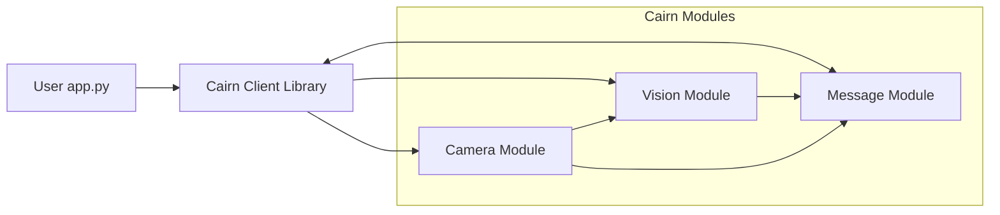
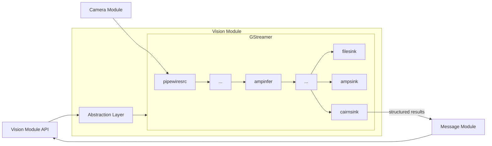

:::info Proposed module
This page captures the current proposal for decomposing the `amp-dev-forge` experience kit into Cairn SDK service boundaries. It is a design note, not a description of a finished runtime surface.
:::

## Why this module may be valuable

The `amp-dev-forge` repository demonstrates a strong reference implementation for media-driven vision workflows. Today, its entry points are the `amp-menu` launcher and direct GStreamer pipeline composition. A proposed Cairn Vision Module builds on that foundation by exposing those same vision capabilities through Cairn’s service model, making them easier to integrate into existing applications, easier to compose with other SDK modules, and less dependent on direct GStreamer integration at the application layer.

For Cairn SDK, this helps establish vision pipelines as a first-class feature with clearer contracts for workflows, sessions, results and events, and provides a natural integration point between the Camera Module, the Message Module and future output or preview capabilities.

## Potential benefits of a dedicated Vision Module include:
- **Service-oriented API**: A dedicated Vision Module can provide a stable, high-level API that abstracts away the complexities of GStreamer and media processing, making it easier for applications to leverage vision capabilities without needing to manage low-level details.
- **Workflow management**: The module can manage the lifecycle of vision workflows, including session management, event handling, and result delivery, providing a more coherent and application-friendly integration surface.
- **Event semantics**: By defining clear event semantics for vision-related events (e.g., workflow started, workflow stopped, source degraded), the module can help applications react appropriately to changes in vision processing state and results.
- **Integration with other modules**: The Vision Module can integrate with the Camera Module for input and the Message Module for event and result transport, providing a cohesive toolkit for media-driven applications.
- **Path to semantic events**: Over time, structured workflow results could support higher-level semantic events such as stable presence/absence signals for people or faces, as well as source and workflow state changes, making it easier for applications and other SDK modules to react to meaningful conditions.

## Cairn Integration Overview

*In this proposed model, user applications interface with the Vision Module through the Cairn Client Library, which provides a high-level API for managing vision workflows, sessions, and results. The Vision Module depends on the Camera Module for video input and the Message Module for event and result transport.*



## Vision Module Overview

*In this proposed model, an abstraction layer inside the Vision Module compiles application-facing workflow definitions into GStreamer pipelines that execute the requested vision workloads using components from the `amp-dev-forge` experience kit. The module manages the lifecycle of these pipelines and translates their outputs into structured results and events that are emitted through the Message Module.*



## Workflow model

The public Vision Service API is workflow-oriented in this proposed model.

Applications define:

- what source is used (camera id, evaluated by the camera service)
- which analysis stages run
- how stages are connected
- what outputs are produced

This is intentionally pipeline-shaped, but is not a raw GStreamer graph. The API abstracts away GStreamer-specific concepts and focuses on the composition semantics that applications care about.

## Provisional application shape

The client SDK remains a thin shim over services in this proposed model. It does not implement workflow semantics by itself.

Conceptually, the application looks something like this:

```python
from cairn import VisionClient
from cairn import NotificationClient
import asyncio


vision = VisionClient()
notifications = NotificationClient()

session = vision.start_workflow(
    source={"camera_id": "front-camera"},
    workflow={
        "stages": [
            {"id": "detector", "kind": "object_detection", "model": "yolo"},
        ]
    },
    outputs={
        "results": True,
        "webrtc": {"annotated": True},
    },
)

def handle_camera_disconnect(notification):
  if notification.camera_id == session.source["camera_id"]:
    session.stop()

notifications.subscribe(
	"camera.disconnected",
	handle_camera_disconnect
)

notifications.subscribe(
	"vision.webrtc.ready",
	lambda notification: print(f"Open preview at {notification.viewer_url}"),
)

notifications.subscribe(
	topic="vision.results.ready",
	handler=lambda notification: print(notification.result.detections),
)

```

Under the hood, `start_workflow(...)` is an asynchronous control-plane request to the Vision Service. The service validates the request, translates the declared graph into an internal runtime pipeline, starts the session and returns a `session_id` immediately.
