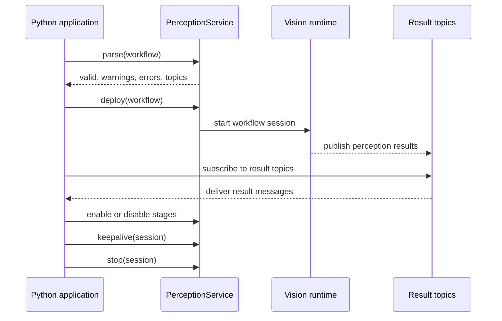

import Tabs from "@theme/Tabs";
import TabItem from "@theme/TabItem";

> This document reflects the API and Documentation that is reflective of the Proposed Implementation outlined in [Proposal 1](https://confluence.arm.com/display/~maudev01/Proposal+1+-+01+-+Overview+and+API). The API and following documentation is WIP.

:::tip Why this module is useful
You can quickly build and deploy complex realtime perception workflows with a simplified interface. Easily spin up several GStreamer workflows without the complexity and overhead of managing them. If you'd rather run your own workflows as GStreamer applications, see [Advanced Perception runtime](/modules/vision-escape-hatch/).
:::

The Vision Module is the Cairn SDK interface for building live camera perception applications.

As an application developer, you work with two main concepts:

- `PerceptionWorkflow`: a Python description of the vision work you want to run.
- `PerceptionService`: the service client that validates, deploys, and controls that workflow.

The SDK keeps the application code focused on intent: which camera to use, which models to run, how stages connect, and where results should be published. The service prepares and runs the camera processing workflow from that description.

## Lifecycle overview



A typical application first builds a workflow, asks the service to parse it, then deploys it as a session. The session represents the running workflow and is the handle used for lifecycle operations such as stage control, keepalive, and stop.

## A minimal workflow

This example defines a single object-detection stage and publishes its results to a named topic.

<Tabs groupId="sdk-language">
<TabItem value="python" label="Python">

```python
from cairn_sdk import (
    CameraService,
    DetectionResults,
    Models,
    PerceptionService,
    PerceptionWorkflow,
    WebViewOutput,
)

# Discover cameras that are currently available.
camera_service = CameraService()
cameras = camera_service.list_camera_metadata()

if not cameras:
    raise RuntimeError("no cameras available")

# Select the camera your workflow should use.
camera = cameras[0]

# Create a named workflow. The name appears in service diagnostics
# and is useful when you have multiple active workflows.
workflow = PerceptionWorkflow(
    name="object-detection",
    camera=camera,
)

# Add one inference stage to the workflow.
objects = workflow.infer(
    "objects",
    Models.object_detection("yolov11"),
)

# Publish structured results for the selected stage.
workflow.output(
    DetectionResults(
        topic="vision.object-detection.objects",
        stages=[objects],
    )
)

# Optionally add preview output for visual inspection.
workflow.output(WebViewOutput())

# Validate the workflow before deploying it.
service = PerceptionService()
parsed = service.parse(workflow)

if not parsed.valid:
    raise RuntimeError(parsed.errors)

# Deploy starts the workflow and returns a session handle.
session = service.deploy(workflow)
```

</TabItem>
<TabItem value="rust" label="Rust">

```rust
use std::collections::HashMap;

use cairn_sdk::camera_service::CameraService;
use cairn_sdk::lvk_service::{
    DetectionResults, Models, PerceptionService, PerceptionWorkflow,
    WebViewOutput,
};

// Discover cameras that are currently available.
let mut camera_service = CameraService::new(None).await?;
let camera = camera_service.get_camera(None).await?;

// Create a named workflow. The name appears in service diagnostics
// and is useful when you have multiple active workflows.
let mut workflow = PerceptionWorkflow::from_camera(
    "object-detection",
    &camera,
);

// Add one inference stage to the workflow.
let objects = workflow.infer(
    "objects",
    Models::object_detection(Some("yolov11"), HashMap::new()),
);

// Publish structured results for the selected stage.
workflow.output(DetectionResults {
    topic: "vision.object-detection.objects".to_string(),
    stages: vec![objects.clone()],
});

// Optionally add preview output for visual inspection.
workflow.output(WebViewOutput {
    http_port: 9999,
    ws_port: 8000,
    ctrl_port: 8001,
});

// Validate the workflow before deploying it.
let mut service = PerceptionService::new(None).await?;
let parsed = service.parse(&workflow).await?;

if !parsed.valid {
    return Err(format!("{:?}", parsed.errors).into());
}

// Deploy starts the workflow and returns a session handle.
let session = service.deploy(&workflow).await?;
```

</TabItem>
</Tabs>

`DetectionResults` publishes structured results to the topic you provide. `WebViewOutput` adds a preview output for workflows where visual inspection is useful.

## Workflow building blocks

| API | Purpose |
| --- | --- |
| `PerceptionWorkflow(name, camera)` | Creates a named live-camera workflow. |
| `workflow.infer(name, model)` | Adds an inference stage. |
| `stage.output("humanFace")` | Selects a named output from a stage, such as detected faces. |
| `workflow.for_each(output).infer(...)` | Runs another model for each item from a previous stage. |
| `workflow.track(name, output, options)` | Adds tracking for detected objects. |
| `workflow.output(DetectionResults(...))` | Publishes structured workflow results to a topic. |
| `workflow.output(PerformanceStats(...))` | Publishes runtime performance measurements to a topic. |
| `workflow.output(WebViewOutput())` | Adds browser preview output. |
| `PerceptionService().parse(workflow)` | Validates and summarises the workflow. |
| `PerceptionService().deploy(workflow)` | Starts the workflow and returns a session. |

Stage output names identify the kind of data a model produces. Common examples are `humanFace` for face detections and `genericObject` for object detections.

`DetectionResults` is the current structured result output type. Despite the name, it can be used for the detection, classification, gaze, and tracking result payloads shown in the examples below.

## Composition patterns

### Single-stage inference

Use a single stage when one model can produce the result your application needs. In this example, the stage is named `classification`, and only that stage is included in the result output.

The following examples assume you have already selected a `camera`, as shown in the minimal workflow above.

<Tabs groupId="sdk-language">
<TabItem value="python" label="Python">

```python
from cairn_sdk import DetectionResults, Models, PerceptionWorkflow

workflow = PerceptionWorkflow(
    name="classification",
    camera=camera,
)

classification = workflow.infer(
    "classification",
    Models.classification("mobilenetv2"),
)

workflow.output(
    DetectionResults(
        topic="vision.classification.results",
        stages=[classification],
    )
)
```

</TabItem>
<TabItem value="rust" label="Rust">

```rust
use std::collections::HashMap;

use cairn_sdk::lvk_service::{
    DetectionResults, Models, PerceptionWorkflow,
};

let mut workflow = PerceptionWorkflow::from_camera(
    "classification",
    &camera,
);

let classification = workflow.infer(
    "classification",
    Models::classification(Some("mobilenetv2"), HashMap::new()),
);

workflow.output(DetectionResults {
    topic: "vision.classification.results".to_string(),
    stages: vec![classification],
});
```

</TabItem>
</Tabs>

### Per-object follow-up inference

Use `for_each(...)` when a second model should run on every item produced by an earlier stage. In this example, face detection produces `humanFace` regions, and gaze detection runs for each detected face.

<Tabs groupId="sdk-language">
<TabItem value="python" label="Python">

```python
from cairn_sdk import DetectionResults, Models, PerceptionWorkflow

workflow = PerceptionWorkflow(
    name="gaze-detection",
    camera=camera,
)

faces = workflow.infer(
    "faces",
    Models.face_detection("ultraface"),
)

gaze = workflow.for_each(
    faces.output("humanFace"),
).infer(
    "gaze",
    Models.gaze_detection(),
)

workflow.output(
    DetectionResults(
        topic="vision.gaze-detection.results",
        stages=[faces, gaze],
    )
)
```

</TabItem>
<TabItem value="rust" label="Rust">

```rust
use std::collections::HashMap;

use cairn_sdk::lvk_service::{
    DetectionResults, Models, PerceptionWorkflow,
};

let mut workflow = PerceptionWorkflow::from_camera(
    "gaze-detection",
    &camera,
);

let faces = workflow.infer(
    "faces",
    Models::face_detection(Some("ultraface"), HashMap::new()),
);

let face_regions = faces.output("humanFace");
let gaze = workflow.for_each_output(&face_regions).infer(
    "gaze",
    Models::gaze_detection(),
    None::<&str>,
);

workflow.output(DetectionResults {
    topic: "vision.gaze-detection.results".to_string(),
    stages: vec![faces, gaze],
});
```

</TabItem>
</Tabs>

### Tracking

Use tracking when your application needs stable object identities across frames. The tracker consumes the `genericObject` output from object detection.

<Tabs groupId="sdk-language">
<TabItem value="python" label="Python">

```python
from cairn_sdk import (
    DetectionResults,
    Models,
    PerceptionWorkflow,
    TrackerOptions,
)

workflow = PerceptionWorkflow(
    name="object-tracking",
    camera=camera,
)

objects = workflow.infer(
    "objects",
    Models.object_detection("yolov11"),
)

tracks = workflow.track(
    "tracks",
    objects.output("genericObject"),
    TrackerOptions(),
)

workflow.output(
    DetectionResults(
        topic="vision.object-tracking.tracks",
        stages=[objects, tracks],
    )
)
```

</TabItem>
<TabItem value="rust" label="Rust">

```rust
use std::collections::HashMap;

use cairn_sdk::lvk_service::{
    DetectionResults, Models, PerceptionWorkflow, TrackerOptions,
};

let mut workflow = PerceptionWorkflow::from_camera(
    "object-tracking",
    &camera,
);

let objects = workflow.infer(
    "objects",
    Models::object_detection(Some("yolov11"), HashMap::new()),
);

let object_regions = objects.output("genericObject");
let tracks = workflow.track_output_with_options(
    "tracks",
    &object_regions,
    TrackerOptions::default(),
);

workflow.output(DetectionResults {
    topic: "vision.object-tracking.tracks".to_string(),
    stages: vec![objects, tracks],
});
```

</TabItem>
</Tabs>

## Results, outputs, and events

A workflow can publish several kinds of output. The most common output is a structured result topic for one or more stages.

<Tabs groupId="sdk-language">
<TabItem value="python" label="Python">

```python
workflow.output(
    DetectionResults(
        # Application code can subscribe to this topic to receive results.
        topic="vision.object-detection.objects",

        # Only these stages are included in the emitted result payload.
        stages=[objects],
    )
)
```

</TabItem>
<TabItem value="rust" label="Rust">

```rust
workflow.output(DetectionResults {
    // Application code can subscribe to this topic to receive results.
    topic: "vision.object-detection.objects".to_string(),

    // Only these stages are included in the emitted result payload.
    stages: vec![objects.clone()],
});
```

</TabItem>
</Tabs>

`parse()` and `session.topics()` report the topics associated with a workflow:

<Tabs groupId="sdk-language">
<TabItem value="python" label="Python">

```python
parsed = service.parse(workflow)
print(parsed.topics())

session = service.deploy(workflow)
print(session.topics())
```

</TabItem>
<TabItem value="rust" label="Rust">

```rust
let parsed = service.parse(&workflow).await?;
println!("{:?}", parsed.topics);

let session = service.deploy(&workflow).await?;
println!("{:?}", session.topics);
```

</TabItem>
</Tabs>

The returned mapping can include:

- `results`: the default or primary structured result topic.
- `events`: the runtime event topic.
- `performance`: the performance statistics topic, if configured.

If you configure explicit `DetectionResults` outputs, the topic string you provide is the application contract for that result stream. Keep that topic in a constant when another part of your application subscribes to it.

<Tabs groupId="sdk-language">
<TabItem value="python" label="Python">

```python
OBJECTS_TOPIC = "vision.object-detection.objects"

workflow.output(
    DetectionResults(
        topic=OBJECTS_TOPIC,
        stages=[objects],
    )
)

session = service.deploy(workflow)
print(session.topics())
```

</TabItem>
<TabItem value="rust" label="Rust">

```rust
const OBJECTS_TOPIC: &str = "vision.object-detection.objects";

workflow.output(DetectionResults {
    topic: OBJECTS_TOPIC.to_string(),
    stages: vec![objects.clone()],
});

let session = service.deploy(&workflow).await?;
println!("{:?}", session.topics);
```

</TabItem>
</Tabs>

`session.topics()` is useful for discovery and diagnostics. For workflows with multiple explicit result outputs, use the configured topic names directly for each result stream.

### Runtime events

Runtime events describe workflow lifecycle activity. You can choose the event topic before deploying the workflow:

<Tabs groupId="sdk-language">
<TabItem value="python" label="Python">

```python
workflow.set_events_topic("vision.object-detection.events")

parsed = service.parse(workflow)
print(parsed.topics()["events"])
```

</TabItem>
<TabItem value="rust" label="Rust">

```rust
workflow.set_events_topic("vision.object-detection.events");

let parsed = service.parse(&workflow).await?;
println!("{:?}", parsed.topics.events);
```

</TabItem>
</Tabs>

Events are separate from model results. Use result topics for perception output, and event topics for runtime state and lifecycle information.

Runtime events use the `perception.events.v1` schema. Each event includes the workflow name, session id, timestamp, event `type`, `severity`, `source`, human-readable `message`, and a `payload` object for event-specific details.

Common event types include `starting`, `running`, `stopping`, `stopped`, `keepalive_timeout`, and `stage_control_error`.

### Performance output

Use `PerformanceStats` when your application needs runtime measurements as a separate stream.

<Tabs groupId="sdk-language">
<TabItem value="python" label="Python">

```python
from cairn_sdk import PerformanceStats

workflow.output(
    PerformanceStats(topic="vision.object-detection.performance")
)
```

</TabItem>
<TabItem value="rust" label="Rust">

```rust
use cairn_sdk::lvk_service::PerformanceStats;

workflow.output(PerformanceStats {
    topic: "vision.object-detection.performance".to_string(),
});
```

</TabItem>
</Tabs>

### Preview output

Use `WebViewOutput` when you want a visual preview of the running workflow.

<Tabs groupId="sdk-language">
<TabItem value="python" label="Python">

```python
workflow.output(
    WebViewOutput(
        http_port=9999,
        ws_port=8000,
        ctrl_port=8001,
    )
)
```

</TabItem>
<TabItem value="rust" label="Rust">

```rust
workflow.output(WebViewOutput {
    http_port: 9999,
    ws_port: 8000,
    ctrl_port: 8001,
});
```

</TabItem>
</Tabs>

## Service and session control

`parse()` is useful during development because it reports whether the workflow can be deployed and which topics it will use.

<Tabs groupId="sdk-language">
<TabItem value="python" label="Python">

```python
service = PerceptionService()
parsed = service.parse(workflow)

print(parsed.valid)
print(parsed.warnings)
print(parsed.errors)
print(parsed.topics())
```

</TabItem>
<TabItem value="rust" label="Rust">

```rust
let mut service = PerceptionService::new(None).await?;
let parsed = service.parse(&workflow).await?;

println!("{}", parsed.valid);
println!("{:?}", parsed.warnings);
println!("{:?}", parsed.errors);
println!("{:?}", parsed.topics);
```

</TabItem>
</Tabs>

- `valid` tells you whether the workflow can be deployed.
- `warnings` are non-blocking issues or suggestions.
- `errors` explain why an invalid workflow cannot be deployed.
- `topics()` lists the result and event topics associated with the workflow.

After deployment, the returned session is the application handle for the running workflow.

<Tabs groupId="sdk-language">
<TabItem value="python" label="Python">

```python
session = service.deploy(workflow)

print(session.id)
print(session.state)
print(session.topics())
```

</TabItem>
<TabItem value="rust" label="Rust">

```rust
let session = service.deploy(&workflow).await?;

println!("{}", session.id);
println!("{:?}", session.state);
println!("{:?}", session.topics);
```

</TabItem>
</Tabs>

### Enable and disable stages

A deployed session can enable or disable controllable inference stages at runtime. Pass the stage handle returned when you built the workflow.

<Tabs groupId="sdk-language">
<TabItem value="python" label="Python">

```python
# Disable a stage while keeping the session active.
session.disable(objects)
print(session.disabled_stages)

# Re-enable the same stage later.
session.enable(objects)
print(session.disabled_stages)
```

</TabItem>
<TabItem value="rust" label="Rust">

```rust
// Disable a stage while keeping the session active.
let mut session = service.disable(&session, &objects).await?;
println!("{:?}", session.disabled_stages);

// Re-enable the same stage later.
session = service.enable(&session, &objects).await?;
println!("{:?}", session.disabled_stages);
```

</TabItem>
</Tabs>

The call returns after the service has applied the stage-control request or raised an error. The updated session state is reflected in `session.disabled_stages`. If a disabled stage feeds downstream stages or result outputs, those downstream results may also pause until the stage is enabled again.

This is useful for workflows with optional stages, such as a model that should only run when the application needs extra detail.

### Keepalive and stop

Use keepalive while your application is actively using the session, then stop the session when the workflow is no longer needed.

<Tabs groupId="sdk-language">
<TabItem value="python" label="Python">

```python
with session.keepalive(timeout_seconds=30, interval_seconds=10):
    run_application_logic()

session.stop()
```

</TabItem>
<TabItem value="rust" label="Rust">

```rust
let mut session = service.keepalive_start(&session, 30.0).await?;

while run_application_logic().await? {
    session = service.keepalive_ping(&session).await?;
}

session = service.keepalive_stop(&session, "normal_exit").await?;
service.stop(&session).await?;
```

</TabItem>
</Tabs>

## Under the hood

When a workflow is deployed, the Vision runtime turns the Python workflow description into a live camera processing session. It connects the selected camera, runs the requested model stages, applies any stage-to-stage relationships such as `for_each` or tracking, and publishes the configured outputs.

This means the public API stays workflow-oriented even though the runtime is doing media processing, model execution, and result delivery behind the scenes.

If your application needs to own the lower-level runtime graph directly, see [Advanced Perception runtime](/modules/vision-escape-hatch/).
